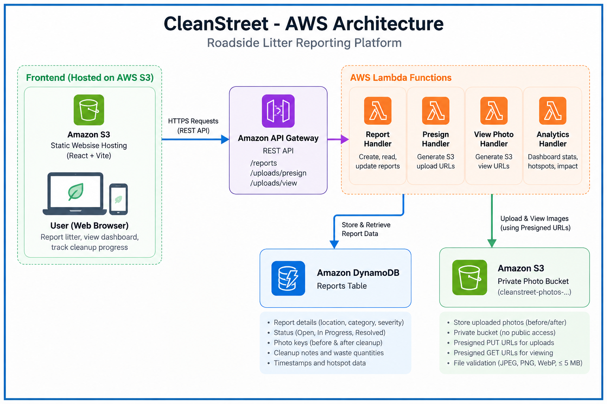

# CleanStreet 🌿

**Roadside Litter Reporting and Cleanup Coordination Platform**

CleanStreet is an environmental hackathon project that lets citizens report roadside waste, administrators coordinate cleanups, and the whole community track progress from open → in-progress → resolved — with photo evidence and transparent priority scoring.

🌐 **[Live Demo](http://cleanstreet-frontend-820697996900.s3-website-us-east-1.amazonaws.com)**

---

## Problem

Roadside litter accumulates because reports are scattered across different channels and cleanup progress is hard to track. There is no single place to see what has been reported, what is being cleaned, and what has been resolved.

## Solution

A web dashboard where:
- **Citizens** submit litter reports with location, severity, category, and optional before-photo.
- **Administrators** update report status, attach cleanup photos, and record waste quantities.
- **Everyone** can see a live priority-ranked hotspot list, cleanup log, and environmental impact.

---

## Features

| Feature | Description |
|---------|-------------|
| **Dashboard** | Summary cards (total/open/in-progress/resolved), top-5 hotspots, 10 recent reports |
| **Report Litter** | Location, waste category, severity, description, optional photo upload (JPEG/PNG/WebP ≤ 5 MB) |
| **Manage Reports** | Filter by status/category/severity, view full detail, advance status, resolve with cleanup note |
| **Hotspot Prioritization** | Transparent priority score: severity + recency + repeat-location bonus (max 7 pts) |
| **Environmental Impact** | Verified resolved count; waste collected shown only when explicitly entered |
| **Image Upload** | Drag-and-drop or click-to-upload; presigned S3 PUT — no credentials in the browser |
| **Demo Data** | 8 clearly-labelled sample reports covering all statuses and categories |

---

## Architecture



```
Browser (React SPA + Vite)
         │
         │ HTTPS  VITE_API_URL
         ▼
Amazon API Gateway  (REST API, prod stage)
         │
         ▼
AWS Lambda  cleanstreet-ReportsFunction  (Node.js 20, esbuild)
    ├─── GET/POST  /reports
    ├─── GET/PATCH /reports/{id}
    ├─── GET        /dashboard
    ├─── POST       /uploads/presign   ← generates S3 presigned PUT URL
    └─── GET        /uploads/view      ← generates S3 presigned GET URL
         │                    │
         ▼                    ▼
Amazon DynamoDB          Amazon S3
CleanStreetReports       Private photo bucket
(PAY_PER_REQUEST)        (no public access)
GSI: StatusIndex
```

**Infrastructure:** AWS SAM (`cleanstreet` CloudFormation stack)  
**Monitoring:** Amazon CloudWatch Logs (auto-enabled via SAM)  
**Frontend hosting:** S3 static website  
**Region:** us-east-1

### AWS Services used

| Service | Purpose |
|---------|---------|
| Amazon API Gateway | REST API routing, CORS |
| AWS Lambda | All backend logic (single function, path-based routing) |
| Amazon DynamoDB | Report storage with GSI for status-filtered queries |
| Amazon S3 (photos) | Private photo storage; browser uploads via presigned PUT URLs |
| Amazon S3 (frontend) | Static website hosting for the React SPA |
| Amazon CloudWatch | Lambda logs and metrics |
| AWS SAM | Infrastructure as code, build, and deployment |

---

## Image Upload Flow

```
1. User selects/drops a file in the browser
2. Browser validates type (JPEG/PNG/WebP) and size (≤ 5 MB) locally
3. POST /uploads/presign  →  Lambda validates again, generates:
     - uploadUrl  (presigned S3 PUT, valid 5 min)
     - key        (e.g. photos/<uuid>.jpg — stored in DynamoDB)
     - viewUrl    (presigned S3 GET, valid 1 hr)
4. Browser PUTs the file directly to S3 using uploadUrl
     ✓ No AWS credentials ever reach the browser
     ✓ File never passes through Lambda
5. key is submitted with the report (photoUrl / afterPhotoUrl field)
6. GET /uploads/view?key=...  →  Lambda generates a fresh presigned GET URL
     (used by the detail panel to display uploaded photos)
```

---

## API Endpoints

| Method | Path | Description |
|--------|------|-------------|
| `GET` | `/dashboard` | Summary stats, top-5 hotspots, 10 recent reports |
| `GET` | `/reports` | List reports. Query: `?status=` `?category=` `?severity=` |
| `POST` | `/reports` | Create a report |
| `GET` | `/reports/{id}` | Get a single report |
| `PATCH` | `/reports/{id}` | Update status, add cleanup note / photos |
| `POST` | `/uploads/presign` | Get a presigned S3 PUT URL for a photo |
| `GET` | `/uploads/view` | Get a presigned S3 GET URL for a stored photo key |

### POST /reports — request body
```json
{
  "location":    "Oak Street & 5th Avenue",
  "category":    "plastic",
  "severity":    "high",
  "description": "Large pile of plastic waste blocking footpath",
  "photoUrl":    "photos/<uuid>.jpg"
}
```

Valid `category`: `plastic` | `household_waste` | `construction_debris` | `other`  
Valid `severity`: `low` | `medium` | `high`

### PATCH /reports/{id} — request body
```json
{
  "status":           "resolved",
  "cleanupNote":      "Area cleared by volunteers",
  "wasteCollectedKg": 12.5,
  "afterPhotoUrl":    "photos/<uuid>.jpg"
}
```

Status transitions: `open → in_progress → resolved`  
`cleanupNote` is **required** when setting `status: resolved`.

### POST /uploads/presign — request body
```json
{ "contentType": "image/jpeg", "fileSizeBytes": 204800 }
```
Response:
```json
{
  "uploadUrl": "https://s3.amazonaws.com/...?X-Amz-Signature=...",
  "key":       "photos/3f2a1b4c-....jpg",
  "viewUrl":   "https://s3.amazonaws.com/...?X-Amz-Signature=..."
}
```

### Error response format
```json
{ "error": "Validation failed", "details": "location is required" }
```

---

## Priority Score Formula

Only open and in-progress reports are ranked:

| Component | Points |
|-----------|--------|
| Severity: high | +3 |
| Severity: medium | +2 |
| Severity: low | +1 |
| Reported ≤ 7 days ago | +3 |
| Reported 8–30 days ago | +2 |
| Reported > 30 days ago | +1 |
| 2+ open reports at same location string | +1 |
| **Maximum** | **7** |

Every hotspot response includes a `breakdown` string explaining the score.

---

## Prerequisites

- Node.js 20+
- AWS SAM CLI ([install guide](https://docs.aws.amazon.com/serverless-application-model/latest/developerguide/serverless-sam-cli-install.html))
- AWS CLI with credentials configured (`aws configure`)
- An AWS account with permissions to create Lambda, API Gateway, DynamoDB, S3, IAM roles

---

## Local Setup

### 1. Clone the repository
```bash
git clone https://github.com/<your-username>/cleanstreet.git
cd cleanstreet
```

### 2. Backend
```bash
cd backend
npm install
npm test        # 24 unit tests — validation and hotspot scoring
```

### 3. Deploy backend to AWS (required before running the frontend)
```bash
cd backend

# Build Lambda bundle with esbuild
sam build

# First-time interactive deploy — follow the prompts
sam deploy --guided
# Stack name: cleanstreet
# Region: us-east-1
# Confirm changes: Y
# Allow SAM IAM role creation: Y

# Get the deployed API URL
aws cloudformation describe-stacks \
  --stack-name cleanstreet \
  --query "Stacks[0].Outputs[?OutputKey=='ApiUrl'].OutputValue" \
  --output text
```

### 4. Frontend
```bash
cd frontend
npm install

# Create your local env file from the example
cp .env.example .env.local
# Edit .env.local and set VITE_API_URL to the API Gateway URL from step 3

npm run dev     # http://localhost:5173
```

### 5. Seed demo data (optional)
```bash
cd backend
TABLE_NAME=CleanStreetReports AWS_REGION=us-east-1 \
  npx ts-node --project tsconfig.json src/seed.ts

# Remove demo data:
TABLE_NAME=CleanStreetReports AWS_REGION=us-east-1 \
  npx ts-node --project tsconfig.json src/seed.ts clear
```

---

## Deployment

### Backend (re-deploy after changes)
```bash
cd backend
sam build
sam deploy \
  --stack-name cleanstreet \
  --region us-east-1 \
  --capabilities CAPABILITY_IAM \
  --no-confirm-changeset
```

### Frontend (deploy to S3 static hosting)
```bash
cd frontend

# Build with your deployed API URL
VITE_API_URL=<your-api-gateway-url> npm run build

# Create a hosting bucket (first time only)
BUCKET=cleanstreet-frontend-<your-account-id>
aws s3 mb s3://$BUCKET --region us-east-1
aws s3api put-public-access-block --bucket $BUCKET \
  --public-access-block-configuration \
  "BlockPublicAcls=false,IgnorePublicAcls=false,BlockPublicPolicy=false,RestrictPublicBuckets=false"
aws s3api put-bucket-website --bucket $BUCKET \
  --website-configuration '{"IndexDocument":{"Suffix":"index.html"},"ErrorDocument":{"Key":"index.html"}}'
aws s3api put-bucket-policy --bucket $BUCKET --policy "{
  \"Version\":\"2012-10-17\",
  \"Statement\":[{\"Effect\":\"Allow\",\"Principal\":\"*\",\"Action\":\"s3:GetObject\",\"Resource\":\"arn:aws:s3:::$BUCKET/*\"}]
}"

# Upload (every deploy)
aws s3 sync dist/ s3://$BUCKET/ --region us-east-1 --delete
aws s3 cp s3://$BUCKET/index.html s3://$BUCKET/index.html \
  --metadata-directive REPLACE \
  --cache-control "no-cache,no-store,must-revalidate" \
  --content-type "text/html"

echo "Live at: http://$BUCKET.s3-website-us-east-1.amazonaws.com"
```

---

## AWS Resources Created by SAM

| Resource | Name | Type |
|----------|------|------|
| CloudFormation stack | `cleanstreet` | Stack |
| Lambda function | `cleanstreet-ReportsFunction` | Node.js 20 |
| API Gateway | `CleanStreetApi` (prod stage) | REST API |
| DynamoDB table | `CleanStreetReports` | PAY_PER_REQUEST |
| DynamoDB GSI | `StatusIndex` | status + createdAt |
| S3 bucket | `cleanstreet-photos-<account>-<region>` | Private photo storage |

---

## Project Structure

```
cleanstreet/
├── backend/
│   ├── template.yaml          # SAM / CloudFormation IaC
│   ├── package.json
│   ├── tsconfig.json
│   └── src/
│       ├── index.ts            # Lambda router
│       ├── seed.ts             # Demo data seeder
│       ├── handlers/
│       │   ├── getDashboard.ts
│       │   ├── getReport.ts
│       │   ├── getReports.ts
│       │   ├── patchReport.ts
│       │   ├── postReport.ts
│       │   ├── postPresign.ts  # S3 presigned PUT URL
│       │   └── getPhotoView.ts # S3 presigned GET URL
│       └── lib/
│           ├── db.ts           # DynamoDB helpers
│           ├── priority.ts     # Hotspot scoring
│           ├── response.ts     # HTTP response helpers
│           ├── types.ts        # Shared TypeScript types
│           └── validation.ts   # Input validation
├── frontend/
│   ├── index.html
│   ├── vite.config.ts
│   ├── tailwind.config.js
│   ├── .env.example            # Copy to .env.local
│   └── src/
│       ├── App.tsx
│       ├── components/
│       │   ├── ImageUpload.tsx  # Drag-drop upload with progress
│       │   ├── Badge.tsx
│       │   ├── Layout.tsx
│       │   └── ...
│       ├── pages/
│       │   ├── Dashboard.tsx
│       │   ├── ReportForm.tsx
│       │   ├── Reports.tsx
│       │   ├── Hotspots.tsx
│       │   └── Impact.tsx
│       └── lib/
│           ├── api.ts          # All API calls + S3 upload
│           ├── types.ts
│           └── utils.ts
└── docs/
    └── architecture.png
```

---

## Known Limitations

- **No authentication** — any user can create or update any report. Add Amazon Cognito for production.
- **No HTTPS on frontend** — S3 static website hosting is HTTP only. Add CloudFront for HTTPS.
- **No geographic coordinates** — hotspot repeat-location detection is case-insensitive string matching. `"Oak St"` and `"Oak Street"` are treated as different locations.
- **No pagination** — DynamoDB `Scan` returns all records. Suitable for a demo; add cursor-based pagination for production scale.
- **CORS open to all origins** — intentional for the hackathon demo. Restrict `AllowOrigin` before production use.
- **Presigned view URLs expire** — GET URLs are valid for 1 hour. Reloading the detail panel generates a fresh URL automatically.
- **No real-time updates** — the UI refreshes on demand only (refresh button). No WebSocket or polling.
- **Photo storage costs** — S3 photos are not automatically deleted. Add a lifecycle policy for production use.
